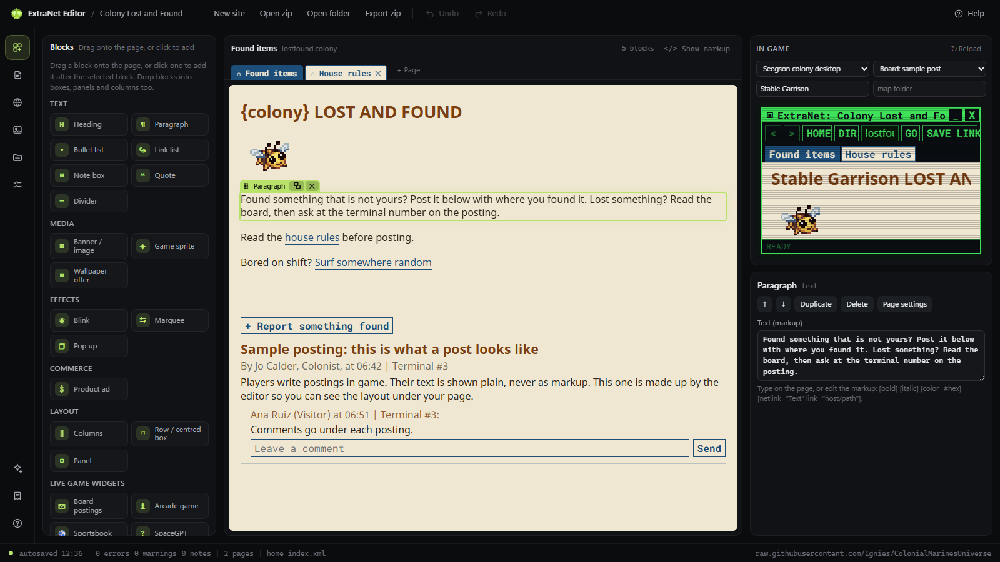
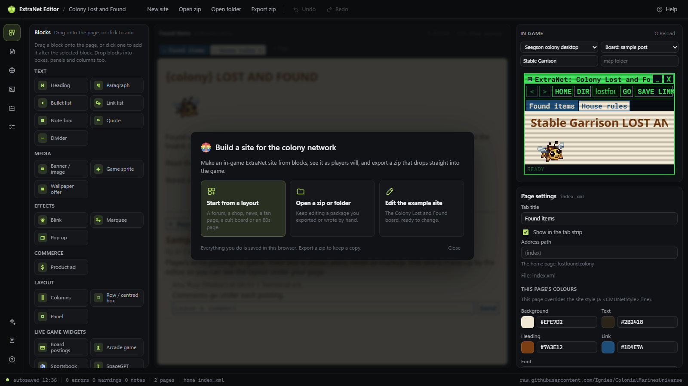
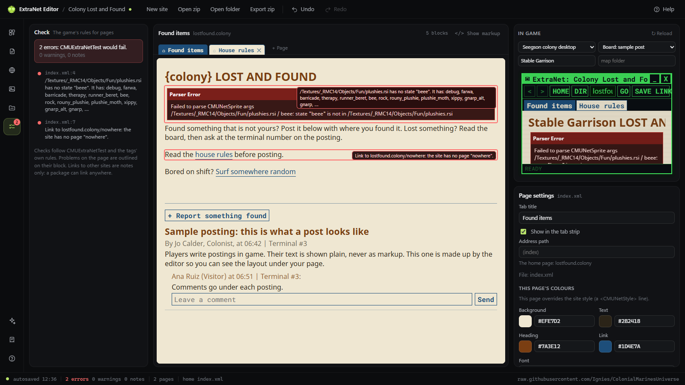
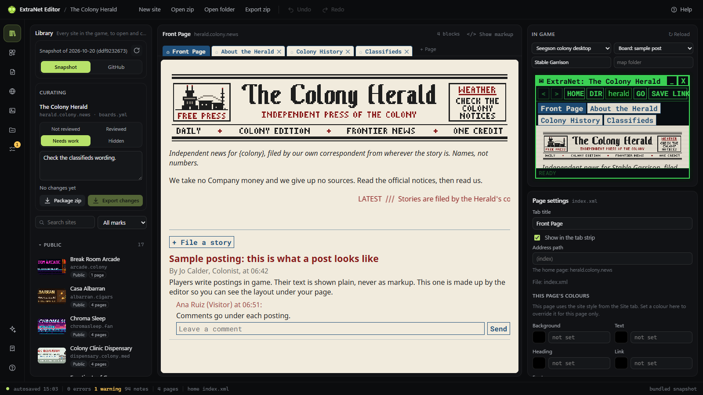
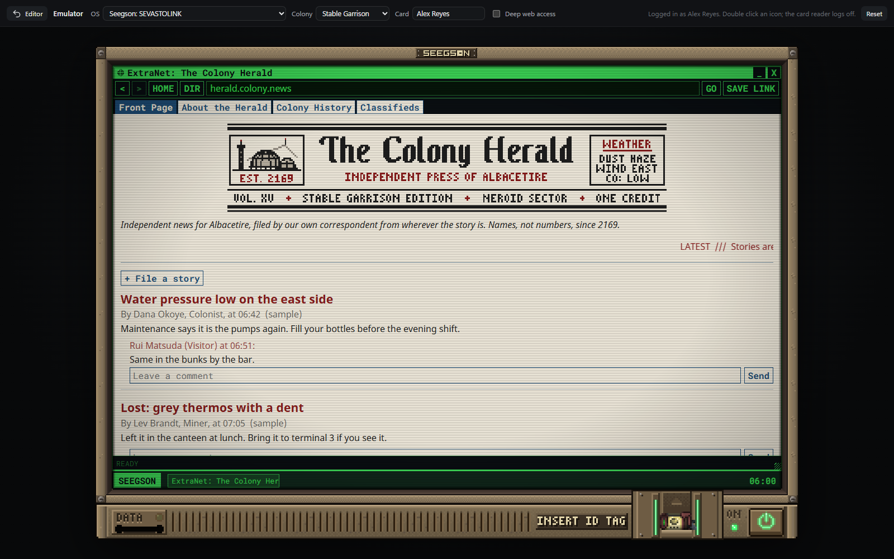
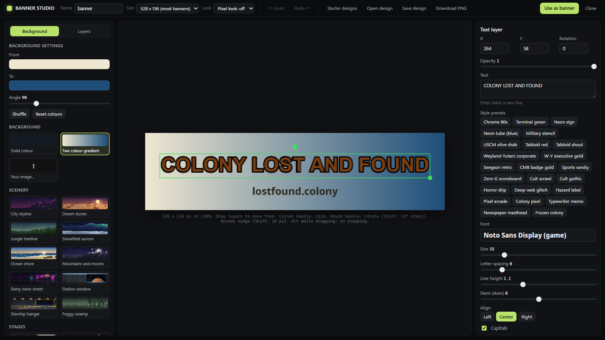

# ExtraNet editor

A static web page for building ExtraNet **site packages**, the in-game web sites players browse on the colony
computers. Pages are built from blocks dragged onto a page drawn in its in-game look. The editor checks them
against the game's rules and exports a zip that goes into the repository with no other edits.

Everything runs in the browser. There is no server and no build step: plain HTML, CSS and ES modules, plus
JSZip from cdnjs.cloudflare.com.

## Hosting

### On your own server

`install.sh` sets up a clean Debian or Ubuntu server: it installs nginx, git and certbot, clones this repository
into `/var/www/extraneteditor`, serves it on `extraneteditor.ignies.net` and gets an HTTPS certificate. Point the
domain's DNS at the server first, then from your own machine:

```bash
ssh root@your-server 'bash -s' < install.sh
```

Settings go before `bash`: `DOMAIN=` for another address, `EMAIL=` for certificate expiry notices, `NO_TLS=1` to
serve plain HTTP. Run it again at any time to update the site to the latest commit. It only adds a server block for its own
domain (`/etc/nginx/sites-available/<domain>`, files in `/var/www/<domain>`), so other sites on the same server
keep working.

### Anywhere else

The folder is the whole app. Any static host works:

- **GitHub Pages**: publish the repository (or a fork) with Pages and open
  `https://<owner>.github.io/<repo>/Content.CMU/Tools/ExtraNetEditor/`. You can also copy this folder to the root
  of a Pages repository of its own.
- **Any web server**: copy the folder and serve it as static files.

Browsers do not run ES modules from `file://`, so opening `index.html` by double clicking only shows a note.

## Running it locally

From this folder:

```
python -m http.server 8000
```

Then open <http://localhost:8000/>.

You can also serve the whole repository, so the editor reads art straight from your checkout (useful for art
that is not pushed yet):

```
cd <repository root>
python -m http.server 8000
```

Open <http://localhost:8000/Content.CMU/Tools/ExtraNetEditor/>, click **Repo** and pick **This checkout**.

## Building a site



The screen follows the CMU Open Vehicles tool:

- **Title bar:** the CMU emblem, the site's name (a dot means changes since the last export), then New site,
  Open zip, Open folder, Export zip, Undo and Redo. Help is on the right. Click the emblem for its colours.
- **Rail** (far left): switches the panel beside it between Blocks, Pages, Site, Images, Files and Check
  (`Alt+1` to `Alt+6`). Clicking the open one again folds the panel away. At the bottom: the Banner Studio, the
  repository setting and help (`F1`). Every button has a tooltip with its shortcut.
- **Middle:** the page you are building, in its in-game look, with the site's tab strip above it.
- **Right:** the page as the game's browser draws it, and below it the settings of the selected block (or of the
  page, when nothing is selected).
- **Status bar:** autosave, the errors, warnings and notes (click to open Check), the page count and the page on
  screen.

On a first visit a welcome card offers three ways to start: a layout, a zip or folder, or the example site. Add
`?welcome` to the address to see it again.



1. **Start.** **New site** offers starter layouts modelled on the game's own sites:
   - blank page;
   - forum or board;
   - shop or brand;
   - news;
   - celebrity fan page;
   - cult or deep forum;
   - 80s retro page.

   Each layout becomes ordinary blocks. You can also open the LostAndFound example, or an existing package
   (**Open zip** or **Open folder**).
2. **Pages are tabs.** The strip above the page has one tab per page, in the site's colours:
   - Click a tab to open it, double click its name to rename it, and drag it to reorder.
   - &#8962; makes a page the home page. Links between the two pages are swapped for you.
   - &#10005; deletes a page, after a confirm.
   - **+ Page** adds a page from a starter layout, or as a copy of the current one.
   - Click empty space on the page for its settings: address path, tab title, whether it shows in the strip, and
     colours that override the site's.
3. **Blocks.**
   - Drag a block from the palette onto the page: between blocks, or into a box, panel, column or blink.
   - Clicking a palette block adds it after the selected block.
   - Drag a block by its &#10303; handle to move it. Its bar has duplicate and delete buttons.
   - Click a block to edit its settings on the right.
   - Type straight onto headings, paragraphs and list items. Selecting text shows a small toolbar for bold,
     italic, colour, links and `{colony}`. A link's target is picked from a list of this site's pages, a random
     site, or another address.
4. **Look.** The **Site** tab holds the site's colours and font. They theme every block live.
5. **Art.**
   - **Game sprite** places a sprite from the repository's RSIs. Use it for anything that exists in game.
   - Upload a PNG only for things with no sprite, such as banners and backgrounds. Each upload needs a
     licence, author and source, which the editor writes to `attributions.yml`.
6. **Check.**
   - The **Check** tab applies the same rules as the game's `CMUExtraNetTest` and the tags themselves.
   - Errors fail the game's tests. A block with a problem is outlined in red on the page, and its problem is
     listed in its settings.
7. **Export zip.**



Other tools:

- **Show markup** swaps the page for its XML. Edits there come back as blocks when you switch back.
- Pasting page markup onto the page turns it into blocks.
- **Undo and Redo:** Ctrl+Z and Ctrl+Y.
- **Selected block:** Del deletes it, Ctrl+D duplicates it, and Alt+Up/Down moves it.
- Work is autosaved in the browser (IndexedDB). Export a zip to keep a copy.

## Blocks and the game tags they write

| Block | Game markup |
|-------|-------------|
| Heading 1, 2, 3 | `#`, `##`, `###` lines (plain text, as the game shows them) |
| Paragraph | a text paragraph with `[bold]`, `[italic]`, `[color=#hex]`, `[netlink]` |
| Bullet list | `- ` lines |
| Link list | `- [netlink="Text" link="host/path"]` lines, with optional text after each link |
| Note box, Quote, Panel | `<ColorBox Color OutlineColor OutlineThickness Margin>` holding one `<Box Orientation="Vertical" HorizontalAlignment="Stretch">` (a ColorBox lays its children on top of each other, so the inner Box stacks them) |
| Divider | an empty `<ColorBox .../>`: a thin line across the page |
| Banner / image | `<CMUGuideImage Path MaxHeight/>` (an uploaded `./name.png` or a `/Textures/...png`) |
| Game sprite | `<CMUNetSprite Rsi State Scale Align/>` |
| Wallpaper offer | `<CMUNetWallpaper Id/>` |
| Blink | `<CMUNetBlink Rate>` around the blocks dropped into it |
| Marquee | `<CMUNetMarquee Text Speed Color/>` |
| Pop up | `<CMUNetPopup Title Text Link LinkText X Y Delay Background Accent Icon/>` |
| Product ad | `<CMUNetAd Id Flip/>` (ads from `deep_ads.yml`) |
| Columns (2 or 3) | `<Box HorizontalAlignment="Stretch">` holding one `<Box Orientation="Vertical" HorizontalAlignment="Stretch" VerticalAlignment="Top" Margin="4">` per column. Stretched boxes expand, so the game shares the width between them. |
| Row / centred box | `<Box>` (a centred row by default: good for a row of sprites) |
| Board postings | the `board:` block in `site.yml`; postings always run under the front page |
| Arcade game | `<CMUNetArcade Game="HuggerRun"/>` or `TrackerReflex` |
| Sportsbook, SpaceGPT | `<CMUNetSportsbook/>`, `<CMUNetSpaceGpt/>` |
| Cookbook | `<CMUNetRecipes Kind="Food" Group/>` (food only) |
| Raw markup | written exactly as typed |
| (page colours) | the page's `<CMUNetStyle .../>` line, set in the page settings |

**Importing.** Pages that are read in (a zip, a folder, pasted markup, or the markup view) become these blocks.
Anything else becomes a raw markup block, so nothing is lost. That includes `<Table>`, CMB panels, the market,
chemistry recipes and nested documents. A `<!-- comment -->` between two blocks is kept as long as those two
blocks stay next to each other.

**Round trips.** Blocks that are not touched are written back byte for byte. All 302 pages in the repository
come back identical, and still equivalent when every block is regenerated from scratch.

**What blocks cannot express:**
- Spacing inside a paragraph across several lines: an edited paragraph is written on one line, which is the
  same to the game.
- A text paragraph that starts with `#` gets an empty `[italic][/italic]` in front, so it is not read as a
  heading.

## The Library: curating the game's own sites

The **Library** panel (the top icon on the rail, <kbd>Alt+0</kbd>) lists every ExtraNet site in the game, grouped
as Public, Boards, Retro, Deep, Corporate / W-Y, Seegson, CMB and Packages. Each row shows the site's banner, title,
address, networks and page count. Search by title, address or id, and filter by curation mark.



- **Open a site** by clicking it. It loads into the block editor like a package: every page, the colony versions
  of pages (`<site root>/<colony>/page.xml`, shown when you type the colony in the preview's map folder box), and
  the site settings. YAML sites keep their titles as locale ids in the game; the editor shows the English text
  from `personal-computers.ftl`.
- **Curate it** in the card at the top: mark it Reviewed, Needs work or Hidden, and write a note. Marks and notes
  are kept in this browser (localStorage), keyed by the site. Hidden sites leave the list unless the filter asks
  for them.
- **Package zip** exports the site as a site package, like any package.
- **Export changes** exports only what changed since the site was opened: the changed and new page files at their
  repository paths (unzip at the repository root), and a `CHANGES.md` that lists them, the pages to delete, and
  any change to the site settings. A YAML site's settings live in a prototype file shared with other sites, so
  `CHANGES.md` describes that edit (and shows the new entry) instead of rewriting the file.

The source is picked at the top of the panel: the bundled snapshot (the default), the Personal-Computers branch
on GitHub, or the checkout the editor is served from.

## The emulator: the in-game computer

The monitor icon on the rail (or `#emulator` at the end of the address, a link you can share) opens the colony
computer full window, built from the game's own code and art:




- **The machine**: the bezel, front panel, card reader, lights and power key drawn from
  `Textures/CMU14/PersonalComputers/Machine/` and the ATM's reader and lights, sliced and scaled as
  `CMUComputerMachine` and `CMUComputerPanel` do. The power key boots it; the card reader takes an ID card in and
  out (logging in and off).
- **The OS**: pick Seegson, Weyland-Yutani or CMB and the colony in the bar. The boot splash, login screen,
  desktop icons, start menu, taskbar and shift clock follow `CMUComputerBootSplash`, `CMUComputerSessionUi`
  and `CMUComputerDesktop`, in the OS's colours (`operating_systems.yml`). Seegson takes the colony's name
  (GARRISONLINK on Stable Garrison).
- **Programs**: the ExtraNet browser (back, forward, home, the directory, the address bar, the site's tabs,
  `net://random`, SAVE LINK to the desktop), Files (the OS's documents and your own notes), Mail (a sample inbox,
  sent mail kept), System (terminal, user, networks, uptime, and the wallpapers).
- **Every site of the Library** answers at its address, with `{colony}` filled and the colony's own versions of
  pages. Networks apply: a Seegson terminal is refused at `intranet.wy`, a W-Y terminal is let in.
- **The site open in the editor** is on the emulator's ExtraNet too, with its pages, tabs, board and `./` images,
  listed in the directory and reachable from links, `net://random` and the address bar. It takes over a game
  site at the same address, so a site being curated shows its edited version. Edits show the next time a page
  loads.
- **Links resolve as `CMUNetBrowser` resolves them**: links, tabs and the HOME, DIR and GO buttons may use a deep
  site's fixed name (`wyleaks.deep`), which opens the site under its random alias in The deeps.exi; typed into
  the address bar a fixed name goes nowhere, as in game.
- **Deep web access** (in the bar) makes it a hacked machine: a corrupted boot and The deeps.exi on the desktop.
  Its scan turns up the deep sites under new random aliases each browser session, and the ad maze that hides the
  hidden ones, generated as `CMUDeepMazeSystem` does: follow the links ending in `::` to unlock a hidden site.
- **Live widgets** run in the pages: boards take postings and comments, the Zero-G Ball sportsbook plays its
  matches with a wallet to bet from, the arcade cabinets play Hugger Run and Tracker Reflex, SpaceGPT answers
  from its roster, the Galley cookbook lists the food recipes (only `Kind="Food"`), and the deep market and the
  Marshals' panels show sample data.
- **Sounds**, as the game plays them (`CMUPersonalComputerBui`): the boot sound when the power key is pressed
  (with a glitch over it on a hacked machine), then after the OS's `bootSoundLength` the running hum, looping
  without a gap until the machine goes off; the shutdown sound; a random keystroke for each key typed in the
  computer's fields; the OS's click on buttons, links and icons; the mail chime when new mail arrives; and the
  error sound as each ad pop up appears. Volumes are the game's. **Sound on/off** and the slider in the bar set
  them, remembered in this browser. Leaving the emulator stops every sound.

**Link check**: open the editor with `?linkcheck` in the address (or run `extranetEditor.linkCheck()` in the
console) to resolve every link, tab, pop up link and `./` file of every page of every site, colony versions
included, through the emulator's resolver, and list what goes nowhere.

What happens on the emulator stays in this browser (notes, mail, links, board posts, the wallet, high scores);
**Reset** in the bar clears it. In game the server keeps those for the round and other players fill the boards,
the market and the Marshals' alerts.

### Sound credits

The computer's sounds are in `game/Content.CMU/Resources/Audio/CMU14/PersonalComputers/` (from the game's
`Content.CMU/Resources/Audio/CMU14/PersonalComputers/`, see its `attributions.yml`). All are from
[Pixabay](https://pixabay.com/sound-effects/) under the Pixabay Content License, trimmed and converted to mono OGG:

| Files | Sound |
|-------|-------|
| `boot_start.ogg`, `running.ogg`, `shutdown.ogg` | Bootup by Freesound community, split into startup, a looping running hum and shutdown |
| `glitch.ogg` | Glitch by Virtual Vibes |
| `click.ogg` | Computer click by Universfield |
| `click_old.ogg` | Old computer click by Finntastico |
| `key_01.ogg` to `key_22.ogg` | Computer keyboard type by Mattyhewvakaliuk73627, cut into single keystrokes |
| `mail.ogg` | Email by Lubecin123 |
| `error.ogg` | Error by Universfield |

## Where game art comes from

The editor reads game data as raw files: pages and site prototypes, sprites (RSIs) and textures, the game's
fonts, product ads (`deep_ads.yml`), wallpapers and locale strings. **Repo** on the rail picks the source:

- **Bundled snapshot** (the default): `game/` in this repository holds the game's ExtraNet content at its
  repository paths: every page and package under `ServerInfo/CMU14/ExtraNet/`, the prototypes in
  `Prototypes/CMU14/PersonalComputers/`, `personal-computers.ftl`, the art in `Textures/CMU14/PersonalComputers/`,
  every other CMU14 texture the pages use, and any referenced file the public master branch lacks.
  `game/index.json` lists the files. Everything else (most game sprites, the fonts) comes from the `master` branch
  on GitHub.
- **A GitHub branch**, such as `https://raw.githubusercontent.com/Ignies/ColonialMarinesUniverse/Personal-Computers/`,
  or a fork.
- **This checkout**: when the editor is served from inside the game repository
  (`Content.CMU/Tools/ExtraNetEditor/`, with the repository root served by `python -m http.server`), it reads
  everything from there, art that is not pushed yet included.

A path like `/Textures/x.rsi` is looked up in `Content.CMU/Resources/Textures/` first, then `Resources/Textures/`,
like the game's merged resource folders.

### Refreshing the snapshot

From this folder, with a checkout of the game repository:

```bash
python tools/snapshot.py path/to/ColonialMarinesUniverse
```

It replaces `game/` with the checkout's current pages, prototypes and art, and prints the size and any path the
pages reference that the checkout lacks. `--master <ref>` sets the branch whose files need no copy (default
`origin/master`; fetch it first). Commit `game/` with the editor.

`data/` ships two snapshots:
- `ad_sprites.json`: the sprite layers of each ad's entity, following `parent:`.
- `jobs.json`: the job ids, for a board's posters.

## Getting a package into the game

1. Unzip the export into `Content.CMU/Resources/ServerInfo/CMU14/ExtraNet/Packages/`. The zip holds one folder
   (for example `LostAndFound/`) with `site.yml`, the pages, the images and `attributions.yml`.
2. That is all. At startup the game loads every folder under `ServerInfo/CMU14/ExtraNet/` that has a
   `site.yml`, with no prototype, locale or C# edits needed.
3. Run the YAML linter and `CMUExtraNetTest`, look at the site in game, and open a pull request with the folder.

See `Content.CMU/Docs/personal-computers.md` ("Contributing pages") for the full rules.

## What the preview matches, and what it does not

The canvas and the preview follow `CMUNetBrowser`, `CMUNetPageView`, the page tags and the guidebook parser:

- **The window:** the terminal window, title bar, navigation bar, the site's tab strip and the status line.
- **Computer themes:** Seegson, Weyland-Yutani and CMB.
- **Page look:**
  - page colours, background image and the five page fonts at the game's sizes;
  - headings, lists and rich text;
  - link colours and the inverted hover.
- **Parser quirks:** a single newline is a space, and a `#` line straight after text is not a heading.
- **Tags:**
  - sprites animated at their RSI delays;
  - blink, marquee and pop ups;
  - ads with their item sprite, wallpapers, images, boxes, columns and panels.
- **Placeholders and paths:**
  - `{colony}` is replaced by the colony name, and colony versions of pages are shown;
  - `./` paths point to the package's own files;
  - links between pages work;
  - unknown hosts and missing pages get the game's error pages;
  - a made-up posting appears under a board's front page.

Differences:

- Text is laid out by the browser, so line breaks can differ by a few pixels.
- On the canvas, pop ups sit in line and blink frames do not blink. The preview shows them as in game.
- Ads that dress a person (`gear:`) show a placeholder.
- Live game widgets (arcade, sportsbook, SpaceGPT, cookbook, CMB panels, market) show a labelled box.
- Links to other sites show the unknown host page. `net://random` shows a placeholder page, and deep sites get a
  made-up address.

## Code

| File | What it does |
|------|--------------|
| `index.html`, `css/editor.css`, `css/builder.css` | The editor's interface. `editor.css` holds the design tokens (colours, radii, spacing), taken from the CMU Open Vehicles tool |
| `js/icons.js`, `img/cmu.png` | Line icons and the CMU emblem, shared with the Open Vehicles tool |
| `docs/` | The screenshots in this README |
| `css/preview.css` | The in-game look |
| `js/main.js` | Wires everything: block operations, pages and tabs, undo, checks, autosave, import and export |
| `js/blocks.js` | Block types, page XML to blocks and back |
| `js/canvas.js` | The block canvas: drawing, selecting, dragging, typing in place |
| `js/richedit.js` | Rich text markup to editable HTML and back |
| `js/ui-props.js`, `js/ui-tabs.js` | The settings panel and the page tab strip |
| `js/templates.js` | Starter layouts |
| `js/history.js` | Undo and redo |
| `js/yaml.js` | `site.yml` and `attributions.yml` reader and writer |
| `js/markup.js`, `js/tags.js` | Page parser (guidebook grammar, Robust rich text) and each tag's attribute rules |
| `js/render.js`, `js/browser.js` | Drawing pages and the in-game browser around them |
| `js/validate.js` | The checks |
| `js/package.js`, `js/zip.js` | The package model, autosave, zip and folder import and export |
| `js/repo.js`, `js/sprites.js`, `js/fonts.js` | Reading the repository or the snapshot: files, RSIs, fonts, ads |
| `js/library.js`, `js/ui-library.js`, `css/library.css` | The Library: the site index, opening YAML sites and packages, curation marks, the changes export |
| `js/emulator/emulator.js`, `css/emulator.css` | The emulator's screen: the bar, the machine on its stage, power, card and the live widgets |
| `js/emulator/machine.js`, `boot.js`, `desktop.js`, `netbrowser.js`, `boards.js` | The machine, the boot splash, the desktop and its programs, the browser, the boards |
| `js/emulator/pcsound.js` | The computer's own sounds (boot, running hum, shutdown, keys, clicks, mail, error) with the mute and volume |
| `js/emulator/net.js`, `data.js`, `linkcheck.js` | The ExtraNet as a computer sees it (addresses, networks, deep aliases, the ad maze), the OS, colony and wallpaper data, and the link check |
| `js/emulator/sports.js`, `arcade.js`, `widgets.js` | Ports of the sportsbook, the arcade games, SpaceGPT, the recipes, the deep market and the CMB panels |
| `game/`, `tools/snapshot.py` | The bundled snapshot of the game's ExtraNet content, and the script that refreshes it |
| `js/editor.js` | The markup view's code editor |
| `js/ui-site.js`, `js/ui-files.js`, `js/ui-sprites.js`, `js/ui-dialog.js` | Site form, files and images, sprite and ad pickers, dialogs |
| `js/template.js` | The LostAndFound example |
| `js/banner/studio.js`, `js/banner/engine.js`, `css/studio.css` | The Banner Studio: its editor, and drawing banners (text effects, sprites, pixel look) |
| `js/banner/backgrounds/`, `js/banner/presets.js`, `js/banner/shape-presets.js`, `js/banner/fonts.js`, `data/banner-designs/` | Banner art: backgrounds, text styles, fonts and starter designs (see below) |

These follow the game's code and need updating when a tag is added or changed:
- the tag list (`DOCUMENT_TAGS` in `js/markup.js`);
- the attribute rules (`js/tags.js`);
- the block types (`js/blocks.js`).

The snapshots in `data/` come from scanning the prototypes:
- `ad_sprites.json`: each `cmuDeepAd` entity's `Sprite` layers.
- `jobs.json`: every `type: job` id.

## Banner Studio

The Banner Studio makes a site's banner PNG.



**Opening it:** the spark button on the rail, **Make banner** in the Images tab, **Design a banner...** in a Banner / image block's settings, or
the tick box in **New site**.

**The canvas:** it works at the real banner size. Most banners in the game are 528x136, which is the default;
the size can be changed.

**What a banner is made of:**
- **Background:** a procedural background with its own colour pickers and sliders, or an uploaded image (cover,
  contain or tile).
- **Text layers:** font, size, spacing, alignment, rotation, upper case and skew. Fill is a colour or a
  gradient. Optional effects: outline, drop shadow, glow, 3D extrude and bevel. One-click style presets set
  several of these at once.
- **Shape layers:** rectangles (with rounded corners), ellipses and circles, lines, arrows, triangles, regular
  polygons, stars and bursts, and free polygons you click point by point and edit by dragging the points (Alt+click
  removes one; open or closed). Each has a fill (none, colour or gradient), a line (colour, width, solid, dashed
  or dotted), rotation, opacity, shadow and glow. **Pixel edges** draws a shape with no smoothing, so it matches the
  chunky in-game art (the 1 px orbit ring on the Spin Okafor banner, for example). Ready-made shapes: orbit ring,
  price burst, panel with frame, ribbon, underline rule, spotlight cone and dashed frame.
- **Sprite layers:** real game sprites from the repository (single RSI states, or the layered item sprites the
  ads use), or uploaded PNGs. Each has whole-step scale, flip, rotation, opacity and shadow.

**Editing:**
- Drag layers on the canvas; the handles scale them and rotate them.
- Arrow keys nudge the selected layer. Layers snap to the centre and the edges.
- The layer list reorders, hides, locks, duplicates and deletes layers.
- Undo and redo work inside the studio.

**Saving:**
- **Use as banner** writes `<name>.png` and `<name>.design.json` into the package and puts the banner on the
  current page. The design file reopens the banner for editing.
- **Download PNG** saves the image only.
- **Pixel look** renders at a half or a third of the size and scales back up without smoothing, for chunky art.

**Licences and the game:**
- The Google fonts are SIL Open Font License fonts. They are used only to draw the PNG; the game only gets the
  image.
- Sprites in a banner are the game's own art (mostly CC-BY-SA-3.0). The banner's attributions entry is filled
  in for you; check it in the Images tab.
- The game ignores `*.design.json`. It only loads `site.yml` (CMUExtraNetSystem.LoadPackages) and the page XML
  each site lists. `CMUExtraNetTest` only parses `.xml` files under a site's folder. The CI attribution check
  only reads `attributions.yml`.

## Banner Studio: adding art

Backgrounds, text style presets, starter designs and the font list are plain modules and data files. Add to
them without touching the studio code.

### Backgrounds: `js/banner/backgrounds/`

One module per background, default-exporting:

```js
export default {
  id: 'starfield',                 // unique, kebab-case
  name: 'Starfield',               // shown in the picker
  tags: ['space', 'retro'],        // optional, for grouping
  params: [                        // the controls the studio shows, in order
    { key: 'bg', label: 'Background', type: 'color', default: '#05070D' },
    { key: 'density', label: 'Density', type: 'range', min: 0, max: 1, step: 0.01, default: 0.5 },
    { key: 'pixel', label: 'Pixel size', type: 'range', min: 1, max: 4, step: 1, default: 2 },
    { key: 'style', label: 'Style', type: 'select', default: 'dots', options: [['dots', 'Dots'], ['streaks', 'Streaks']] },
  ],
  draw(ctx, width, height, params, seed) { /* paint the whole canvas */ },
};
```

List it in `js/banner/backgrounds/index.js`: import it, then add it to `BACKGROUNDS`. The array order is the
picker order.

**The pixel kit:** most backgrounds use `js/banner/backgrounds/_kit.js`, which draws the way the game's hand-made
banners are drawn: on a half-size grid, with ordered dithering between a few ramp colours, scaled up without
smoothing.
- `paint(ctx, width, height, params.pixel, grid => { ... })` hands you a `Grid` to fill pixel by pixel.
- Add the shared `PIXEL` param so the grain can be changed.
- Size things relative to `grid.u` (1 on a 68 pixel tall grid), so the background looks the same in the pixel look
  and as a thumbnail.
- The kit also has `ramp()` (dithered colour steps), `makeNoise()` and `fbm()`, `hash()`, `glow()`, `vignette()`,
  `scanlines()` and a tiny 3x5 pixel font (`grid.text()`).
- Keep a redraw under about 30 ms at 528x136 with Pixel size 1, because the studio redraws while sliders move.

**Picker groups:** four folders hold generic, reusable backgrounds. Each folder has a shared helper (the file
starting with `_`), and every background in it sets `group`.

| Folder | Group | What it is | Shared controls |
|--------|-------|------------|-----------------|
| `scenery/` | Scenery | Landscapes and settings that leave the title side clear | Detail side, Time of day |
| `stages/` | Stages | A lit area on one side for dropping sprites, like The Annex | Stage side, Stage width, Title side, Light |
| `split/` | Split colours | Bold flat colour layouts, like The Colony Tattler | Texture, Texture on, Accent stripe |
| `materials/` | Materials | Full textures, like the planks behind Rosie Ketch | Light from, Vignette |

The older backgrounds are given headings in `index.js` itself.

**Parameters:**
- `type` is `'color'` (a `#RRGGBB` string), `'range'` (a number between `min` and `max`, moved by `step`) or
  `'select'` (`options` is a list of `[value, label]` pairs, or plain strings).
- `draw()` gets `params` as a plain `{ key: value }` object with every default filled in.
- `seed` is a whole number. Use `rng(seed)` from `index.js`, which returns a function giving numbers from 0 to 1,
  so the same seed always draws the same picture. The studio's Shuffle button changes the seed.

**The canvas `draw()` gets:**
- `width` and `height` are the size being rendered: the banner size (e.g. 528x136), divided by 2 or 3 when the
  design's pixel look is on.
- The studio also calls `draw()` with a small size for the picker's thumbnails, so draw relative to `width` and
  `height`, not fixed pixels.
- `ctx` is a fresh 2D context. Its state is saved before `draw()` and restored after, so set anything you need,
  including `imageSmoothingEnabled`.
- You may make offscreen canvases (for example a low resolution buffer you scale up without smoothing).
- Do not load files or fetch anything inside `draw()`: drawing must be synchronous. A background that draws loaded
  files (game textures, RSIs) loads them in `preload()` instead, see below.

**Backgrounds that draw files:** a background may also have
- `preload()`: returns a promise that loads everything it draws with (call it as often as you like; load once).
- `ready()`: true once that has finished.
- `group`: a heading in the picker; grouped backgrounds are listed under it after the ungrouped ones.
- `credit`: text added to the banner's attributions entry by **Use as banner**.

The engine (`js/banner/engine.js`) awaits `preload()` in `prepare()` before it draws a design, so the canvas, the
starter thumbnails and the exported PNG always have the art. The picker's thumbnails draw at once and redraw
themselves when `preload()` resolves. Until then `draw()` should paint a plain stand-in.

### Text style presets: `js/banner/presets.js`

Add to `PRESETS` an object `{ id, name, style }`. `style` holds any of the text layer fields below. Applying a
preset copies them onto the selected text layer. A field set to `null` turns that effect off; a field left out
keeps the layer's own value.

Text layer fields (also the format inside a design file):

| Field | Value |
|-------|-------|
| `font` | a font `id` from `js/banner/fonts.js` |
| `size` | font size in pixels |
| `weight` | optional, overrides the font's weight |
| `letterSpacing` | extra pixels between letters (may be negative) |
| `lineHeight` | line height as a multiple of the size, default 1.1 (text may hold `\n`) |
| `align` | `'left'`, `'center'` or `'right'`, around the layer's `x` |
| `upper` | `true` to draw in capitals |
| `skew` | degrees of slant, positive leans right (italic is about 12) |
| `fill` | `{ type: 'solid', color: '#hex' }` or `{ type: 'gradient', angle: deg, stops: [{ at: 0..1, color }] }`; angle 0 runs left to right, 90 top to bottom |
| `outline` | `{ color, width }` in pixels, or `null` |
| `shadow` | `{ color, blur, x, y }` (offset in pixels), or `null` |
| `glow` | `{ color, blur, strength }` (strength 1 to 3 passes), or `null` |
| `extrude` | `{ depth, angle, color, shade }`: depth in pixels; angle the direction the 3D side goes (0 right, 90 down, 45 down-right); color `null` to use the fill darkened; shade 0..1 darkens towards the back. Or `null`. |
| `bevel` | `{ light, dark, size, strength }`: highlight on the top left edges, shade on the bottom right, size in pixels, strength 0..1. Or `null`. |

Colours are `#RRGGBB`, or `#RRGGBBAA` for transparency.

### Shape presets: `js/banner/shape-presets.js`

Add to `SHAPE_PRESETS` an object `{ id, name, layer }`. `layer` holds shape layer fields; the shape is added
at the middle of the banner. Shape layer fields (also the format inside a design file, with `"type": "shape"`):

| Field | Value |
|-------|-------|
| `shape` | `'rect'`, `'ellipse'`, `'line'`, `'arrow'`, `'triangle'`, `'polygon'`, `'star'` or `'path'` |
| `w`, `h` | width and height in pixels (a line or arrow uses `w` as its length) |
| `radius` | corner radius of a `rect` |
| `sides` | sides of a `polygon`, 3 to 12 |
| `points`, `inner` | points of a `star`, and the inner corners' size as a fraction of the outer (0.05 to 0.98) |
| `path`, `closed` | a free polygon's points `[[x, y], ...]` around the layer's centre, and whether it is closed (a closed one can be filled) |
| `fill` | `null`, or the same `{ type: 'solid', color }` / `{ type: 'gradient', angle, stops }` as text |
| `stroke` | `null`, or `{ color, width, dash }` with dash `'solid'`, `'dashed'` or `'dotted'` |
| `pixel` | `true` for hard pixel edges (no smoothing) |
| `shadow`, `glow` | as for text |

Plus the common layer fields `x`, `y` (the centre), `rotation` and `opacity`.

### Fonts: `js/banner/fonts.js`

`FONTS` lists `{ id, name, family, weight, google, game, tones }`:
- `family` is the CSS family name.
- `google` is the Google Fonts css2 `family=` value (for example `'Orbitron:wght@400;700;900'`), or `null` for
  the game's own fonts.
- `game` is the page font name (`Sans`, `Display`, `Mono`, `Terminal`, `Pixel`) for the game's fonts.
- `weight` is the weight the studio draws with.
- `tones` are free tags.

Each Google font loads on its own, so one bad name cannot break the others. Only use OFL fonts.

### Starter designs: `data/banner-designs/`

Each starter is a design file, in the same format as a saved `banner.design.json`. List them in
`data/banner-designs/index.json`:

```json
[
  { "file": "terminal.json", "name": "Terminal notice", "tags": ["terminal"] }
]
```

A design file:

```json
{
  "format": "cmu-extranet-banner",
  "version": 1,
  "name": "Terminal notice",
  "width": 528,
  "height": 136,
  "pixel": 1,
  "background": { "type": "procedural", "id": "scanlines", "seed": 1, "params": { "base": "#0A0E12" } },
  "layers": [
    {
      "id": "title", "type": "text", "name": "Title", "visible": true, "locked": false,
      "x": 264, "y": 60, "rotation": 0, "opacity": 1,
      "text": "NOTICE BOARD", "font": "vt323", "size": 56, "letterSpacing": 2, "align": "center",
      "upper": true, "skew": 0,
      "fill": { "type": "solid", "color": "#3FE05A" },
      "outline": null, "shadow": null, "glow": { "color": "#3FE05A", "blur": 8, "strength": 2 },
      "extrude": null, "bevel": null
    },
    {
      "id": "bee", "type": "sprite", "name": "Bee plushie", "visible": true, "locked": false,
      "x": 470, "y": 68, "rotation": 0, "opacity": 1, "scale": 2, "flipX": false, "flipY": false,
      "shadow": { "color": "#000000AA", "blur": 0, "x": 2, "y": 2 },
      "source": { "kind": "rsi", "rsi": "/Textures/_RMC14/Objects/Fun/plushies.rsi", "state": "bee" }
    }
  ]
}
```

**Design fields:**
- `pixel` is 1 for the full size, or 2 or 3 for the pixel look.
- `layers` run from back to front.
- A layer's `x` and `y` are its centre, in banner pixels. `rotation` is in degrees.
- A layer's `type` is `"text"`, `"sprite"` or `"shape"` (shape fields are listed under Shape presets above).
- Missing fields take their defaults, so a starter only needs what it changes.

**Backgrounds:**
- A procedural background is `{ "type": "procedural", "id", "seed", "params" }`.
- An image background is `{ "type": "image", "src": "data:image/png;base64,...", "fit": "cover" | "contain" | "tile" }`.

**Sprite sources:**
- `{ "kind": "rsi", "rsi", "state" }`: one RSI state. The first frame, facing south, is used.
- `{ "kind": "layers", "label", "layers": [{ "rsi", "state" }] }`: stacked states, like the ads' item sprites.
- `{ "kind": "image", "label", "src": "data:image/png;base64,..." }`: an uploaded PNG.

**Text:** text layers are drawn as written. A banner is one PNG for every colony, so `{colony}` is not replaced
in banners; do not use it in starter designs.
